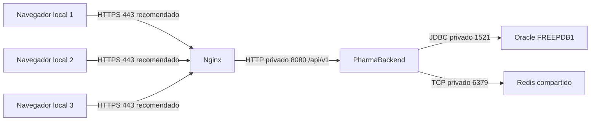

# PharmaSoft

Aplicación SPA para administrar una farmacia, creada con Angular 22 y conectada al backend Spring Boot existente.

## Ejecutar en el navegador

1. Inicia el backend como ya lo ejecutas habitualmente y verifica que esté disponible en `http://localhost:8080`.
2. Abre una terminal en la carpeta `PharmaSoft` e instala las dependencias la primera vez:

   ```powershell
   npm install
   ```

3. Inicia la aplicación:

   ```powershell
   npm start
   ```

4. Abre [http://localhost:4200](http://localhost:4200) e inicia sesión con una cuenta habilitada en tu backend.

Desarrollo usa `src/environments/environment.development.ts` (`http://localhost:8080/api/v1`); producción usa `src/environments/environment.ts` (`/api/v1`). El backend de este proyecto ya permite el origen `http://localhost:4200`; si el origen cambia, configura CORS en el backend por separado. Esta SPA no ejecuta SQL, migraciones ni operaciones en DBeaver.

La preparación de producción se describe en este README. Los informes y las capturas se entregan por separado.

## Funcionalidades

- Inicio de sesión, validación de campos, retorno seguro a la ruta solicitada y mensajes de error.
- Sesión recuperada desde `sessionStorage`, temporizador de expiración y aviso cinco minutos antes del vencimiento.
- Interceptores JWT para la API y manejo de 401 sin cerrar la sesión ante un 403.
- Guards de autenticación y permisos; navegación y botones según los permisos del usuario.
- Consulta y CRUD de categorías y productos; consulta, filtros, registro y detalle de ventas.
- Página «Mi cuenta» con información de sesión y cambio de contraseña.
- Diseño adaptable a teléfono, tableta y escritorio.

## Verificación

```powershell
npm run build
```

La [matriz de pruebas manuales](docs/pruebas-manuales.md) recoge los 16 casos de la guía. Las pruebas que dependen del backend requieren que este se encuentre disponible y que las cuentas de práctica ya estén configuradas.


## Construcción del frontend

```powershell
npm ci
npm run build:stats
docker compose -f deploy/docker-compose.yml up -d
```

Abrir http://localhost:8081/login con el backend de farmacia en 8080. El entorno
production usa /api/v1; development utiliza localhost:8080/api/v1. Las variables
secretas de la tabla siguiente pertenecen al backend y nunca se incrustan en la SPA.
La aplicación conserva NoPreloading. Las herramientas del experimento comparativo
se entregan aparte y no forman parte del programa.

Para desplegar sin detener Nginx, construir en otra carpeta, copiar primero los
assets con hash y reemplazar index.html al final. Mantener assets anteriores por
un período de gracia. Para rollback, restaurar el index de la versión previa y
sus assets conservados, y recargar normalmente (index siempre se revalida).

## Despliegue en producción

### Arquitectura y puertos



En laboratorio: navegador → localhost:8081 → contenedor Nginx:80; API en el
anfitrión:8080; Oracle publicado en localhost:1522 hacia el listener del contenedor
1521; Redis en 127.0.0.1:6379. El navegador nunca consulta Oracle ni Redis.
HTTPS 443 es una recomendación pendiente, no una función ya configurada.

### Variables de entorno

| Variable | Propósito |
|---|---|
| JAVA_HOME | Instalación de Java 21 para construir y ejecutar |
| SPRING_PROFILES_ACTIVE | Seleccionar prod; evita el perfil local en servidores |
| DB_URL | URL JDBC del Oracle de destino |
| DB_USERNAME | Usuario Oracle de la aplicación con permisos mínimos |
| DB_PASSWORD | Contraseña Oracle; solo entorno o gestor de secretos |
| JWT_SECRET | Clave de firma Base64 de al menos 256 bits; diferente por entorno |
| FRONTEND_ORIGINS | Lista exacta de orígenes autorizados, sin comodines |
| REDIS_HOST / REDIS_PORT | Dirección privada y puerto de Redis |
| REDIS_PASSWORD | Autenticación de Redis cuando se configure en producción |

No se publican valores reales. application-local.properties, .local/ y logs/ están
excluidos de Git. No copies esos archivos a un repositorio ni uses la clave de
desarrollo para producción. Las credenciales de las pruebas se leen de un archivo
local ignorado o del entorno, nunca de las capturas o informes.

### Construir y desplegar el sistema

1. Configura las variables anteriores en el proceso del servicio. Aprovisiona
   antes el esquema Oracle y sus copias de seguridad; prod usa ddl-auto=validate
   y no ejecuta migraciones automáticamente.
2. Con Java 21: `./mvnw.cmd clean package` en Windows o `./mvnw clean package`
   en Linux. Conserva el JAR, su hash y el commit en una carpeta de versiones.
3. Inicia una sola instancia: `java -jar target/tienda-0.0.1-SNAPSHOT.jar
   --spring.profiles.active=prod`. Comprueba que 8080 esté libre.
4. Desde el frontend, construye y levanta Nginx/Redis con el Compose de deploy.
   No levantes otra instancia Redis en el mismo puerto. La SPA se sirve por el
   proxy y usa /api/v1 relativo.
5. Verifica health público sin detalles, health de admin con db/redis UP, login,
   permisos, un listado y una operación de prueba. Revisa logs sin secretos.

El lanzador scripts/iniciar-backend.ps1 sirve para este laboratorio. Acepta
JAVA_HOME y variables externas; sus valores por defecto describen esta máquina.
En un servidor usa un gestor de procesos y la configuración de su propio entorno.

### Volver a una versión anterior

1. Conserva el JAR anterior y el commit correspondiente antes del despliegue.
2. Si falla health o una verificación funcional, detén solo la instancia nueva,
   ejecuta el JAR anterior con las mismas variables del entorno y verifica health.
3. Restaura también el index y assets de la versión frontend compatible. No borres
   de inmediato los assets con hash que todavía puedan usar pestañas abiertas.
4. Si una futura versión cambia el esquema, prepara antes una migración reversible
   o un plan de restauración de Oracle. No asumas que cambiar el JAR revierte datos.

### Estado de buenas prácticas

| Práctica | Estado | Acción pendiente o alcance |
|---|---|---|
| Rutas y reporte diferidos en SPA | Cumple | Ver README del frontend y mediciones A |
| Presupuestos y hash de bundles | Cumple | Seguir revisando cada build |
| Caché navegador y proxy Nginx | Cumple | Ver tabla B y prueba de despliegue |
| TTL e invalidación de catálogos/ventas | Cumple | Matriz C secuencial verificada; TTL final 10m |
| Caída de Redis y continuidad desde Oracle | Cumple | health informa DOWN; no equivale a alta disponibilidad |
| requestId en logs y errores; visible en SPA | Cumple | Incluye errores de seguridad y negocio |
| Logs sin credenciales, tokens ni DNI completo | Cumple | Auditoría D de esta ejecución; repetir continuamente |
| Actuator con permisos | Cumple | Health público limitado; métricas requieren administrador |
| Perfil prod y secretos externos | Cumple | Operador debe aprovisionar los secretos de cada entorno |
| HTTPS, aislamiento de red y credenciales Redis | Parcial | Configurar certificados, firewall, ACL y red privada |
| Backups Oracle y restauración ensayada | No cumple | Definir retención, destino y simulacro de recuperación |
| Alarmas y continuidad entre tres locales | Parcial | Configurar alertas, monitoreo externo y plan de caída WAN |
| Consistencia bajo concurrencia/múltiples nodos | Parcial | Probar ventas concurrentes y particiones de red |

### Tres recomendaciones priorizadas para los locales

1. **Seguridad del acceso:** HTTPS en Nginx, acceso entre locales por red privada
   o VPN, Oracle y Redis sin exposición pública, mínimos privilegios y rotación
   de secretos. La demostración HTTP local no sustituye estas medidas.
2. **Recuperación de datos:** backups cifrados de Oracle fuera del servidor,
   retención y restauración ensayada; un único Oracle y Redis compartidos para
   mantener catálogos coherentes. Redis es caché, no respaldo de las ventas.
3. **Operación y alertas:** monitoreo de health/latencias/errores desde fuera del
   servidor, alertas si Redis o Oracle caen, logs correlacionados y despliegues por
   versiones con rollback. Medir la conexión de cada local antes de activar precarga.


## Actividad autónoma S13

El informe, las capturas para la presentación y las herramientas de medición se
entregan por separado. El proyecto conserva el código de la aplicación y sus
mejoras, sin informes PDF ni capturas académicas dentro de sus carpetas.

## Sesión 14: probar la integración

Abre http://localhost:8081/login después de ejecutar el lanzador de la práctica. `npm start` también ofrece desarrollo en http://localhost:4200.

- Productos: búsqueda en servidor, orden por nombre/precio/stock, tamaño y página en la URL. Recargar conserva la página.
- Ventas: filtros de cliente/estado/fechas y paginación. Cambiar filtros, tamaño u orden vuelve a la página 1.
- Clientes: registro y consulta según permisos. El cliente nuevo se encuentra en Nueva venta.
- Nueva venta: buscadores en servidor, productos activos con existencias, detalle y comprobante. El borrador se conserva en esta pestaña por usuario para recuperarlo al iniciar sesión nuevamente.
- Auditoría: menú exclusivo de administración, filtros y requestId para seguir una operación.
- El reporte de productos más vendidos sigue en Inicio para administración.

### Pruebas de navegador

Ejecuta `npm ci`, luego `npm run e2e` o `npm run e2e:estable` para repetir siete pruebas tres veces. Chrome instalado, un worker y cero reintentos. Backend y Redis deben estar encendidos. Variables opcionales: `E2E_ADMIN_PASSWORD`, `E2E_VENDEDOR_PASSWORD`, `E2E_ALMACEN_PASSWORD`. Los valores predeterminados son cuentas de demostración de la guía. Cambiarlos en un servidor real. No versionar credenciales reales.

Reportes y trazas: carpetas ignoradas `playwright-report/` y `test-results/`. Incidencias: `docs/incidencias.md`. La presentación se preparará aparte cuando se solicite.
